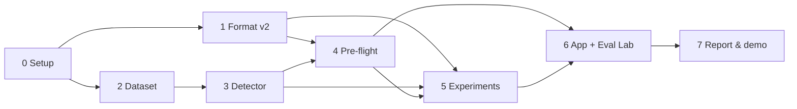

# StegoShield: Project Phases

This is the authoritative definition of the development phases. Scope comes from [revised_proposal.md](revised_proposal.md); the short schedule view is [week_plan.md](week_plan.md). When the two disagree, this file wins.

**How to read a phase.** Each phase has the same six parts:

| Part | Meaning |
|---|---|
| **Goal** | The one outcome the phase exists to produce. |
| **Depends on** | Phases that must be closed first. |
| **Tasks** | The work, as a checklist. |
| **Deliverables** | Files that must exist (or change) when the phase closes. |
| **Exit criteria** | Checks that must all pass. A phase is not done until every box is ticked. |
| **Not in this phase** | Work that belongs elsewhere, to stop scope creep. |

**Status legend:** ✅ Done · 🟡 In progress · ⬜ Not started

---

## Overview

| # | Phase | Module(s) | Depends on | Estimate | Status |
|---|---|---|---|---|---|
| 0 | Setup & hygiene | all | none | ½ day | ✅ |
| 1 | Secure format v2 | A, C | 0 | 1 day | ✅ |
| 2 | Dataset | D | 0 | ½–1 day | ✅ |
| 3 | Detector | D | 2 | 1 day | ✅ |
| 4 | Pre-flight check | B | 1, 3 | ½ day | ✅ |
| 5 | Experiments | all | 1, 3, 4 | 1 day | ✅ |
| 6 | Web app + Evaluation Lab | UI, API | 4, 5 | 2 days | 🟡 |
| 7 | Report & demo | none | 6 | 1 day | ⬜ |

Total: about 6½–7 working days.

Phases 1 and 2 are independent and can run in parallel if two people are available.

---

## Rules that apply to every phase

**Phase gate (Definition of Done):**
- [ ] All exit criteria for the phase are ticked.
- [ ] `pytest` is green with no new warnings, and runs in under 10 s (slow tests marked `@pytest.mark.slow`).
- [ ] New behaviour has tests, including failure paths.
- [ ] Docs touched by the change are updated in the same commit (`payload_format.md`, `security_results.md`, `README.md`).
- [ ] The phase's status in the overview table above is updated.
- [ ] One commit (or a short series) on `main` with a message of the form `phase N: <what changed>`.

**Standing rules:**
- Never refactor and add features in the same commit.
- Datasets, cover images, and stego images are never committed. Only code, small fixtures, the final `models/detector.joblib`, metrics JSON, and figures are.
- Every script that uses randomness takes a seed and records it in its output.

**If time runs short, cut in this order:** LSB-matching experiments → resize robustness test → detector comparison in the Evaluation Lab. Nothing in Phases 1, 3, or 4 is cuttable.

---

## Phase 0: Setup & hygiene ✅

**Goal:** A clean, reproducible environment that anyone on the team can set up and run in five minutes.

**Depends on:** none

**Tasks:**
- [x] Python 3.12 `.venv`
- [x] Test suite green (56 passing, 8 s)
- [x] Remove duplicated README content
- [x] Fix Pillow `mode=` deprecation warnings
- [x] Pin exact versions in `requirements.txt` (`pip freeze`-checked, `==` not `>=`)
- [x] Split dev-only tools (`pytest`, `ruff`) into `requirements-dev.txt`
- [x] Add `ruff` for linting and formatting; one config in `pyproject.toml`
- [x] Register the `slow` pytest marker in `pyproject.toml`
- [x] Confirm `streamlit run app.py` opens with no errors in the terminal

**Deliverables:** `requirements.txt` (pinned), `requirements-dev.txt`, `pyproject.toml`

**Exit criteria:**
- [x] A fresh clone → `python3.12 -m venv .venv && pip install -r requirements-dev.txt && pytest` passes
- [x] `ruff check .` reports zero errors
- [x] `streamlit run app.py` loads all tabs with no exceptions

**Not in this phase:** Streamlit API deprecations inside `app.py` (Phase 6).

---

## Phase 1: Secure format v2 ✅

**Goal:** Embedded bits carry no plaintext markers and give nothing away to anyone without the secret. A wrong key fails safely, and an attacker cannot test password guesses cheaply.

**Depends on:** 0

**Tasks:**
- [x] **Two-stage layout:**
  - Stage 1 holds only random bytes: the salt (password mode) or the one-time public key (asymmetric mode), at positions derived from the password or the recipient's public key.
  - Stage 2 holds nonce, masked length, and ciphertext + tag, at positions derived from the **secret** (PBKDF2 output, or ECDH shared secret, via HKDF).
- [x] Remove `STSH`, version, and mode from the embedded bits. They remain as AAD that AES-GCM authenticates, but are not stored in pixels.
- [x] Mask the length field with a key-derived value.
- [x] Randomise the top bit of the stored X25519 public key (it is always 0 otherwise, so it would leak). Check that the receiver ignores this bit, which RFC 7748 requires.
- [x] Select only the slots needed, instead of permuting every slot in the image.
- [x] Keep the sequential mode as a clearly labelled *baseline only* option.
- [x] Bump the format version constant. v1 payloads do not need to stay readable.

**Deliverables:** updated `core/crypto.py`, `core/embed.py`, `core/pipeline.py`, `docs/payload_format.md` (v2), `tests/security_results.md`

**Exit criteria (each is an automated test):**
- [x] Round-trip works in both modes, with both LSB replacement and LSB matching.
- [x] Extracting with **only the recipient's public key** recovers nothing beyond random bytes.
- [x] Checking a wrong password costs a full PBKDF2 run (no cheap early reject from a stored marker or checksum).
- [x] Bits pulled from a stego image without the key pass a randomness check (e.g. monobit and chi-square at α = 0.01) just as random bytes do.
- [x] A wrong key, a flipped bit, header tampering, or a crop raises `AuthenticationError` or `InvalidPayloadError`. Garbage output never comes back.
- [x] No byte sequence `STSH` appears in the extracted LSB stream.

**Not in this phase:** UI changes (Phase 6), JPEG robustness (Phase 5 only *measures* it).

*Note:* `app.py` Hide & Extract was minimally rewired to the v2 pipeline functions, because the v1 functions it called no longer exist. No other UI changes.

---

## Phase 2: Dataset ✅

**Goal:** A labelled, reproducible feature table built from real photographs, ready for training without leakage.

**Depends on:** 0

**Tasks:**
- [x] `ml/prepare_covers.py`: download DIV2K (validation set, 100 photos) and cut 5 512×512 PNG crops per photo into `data/covers/` (500 covers, fixed seed). *Changed from "one crop per source image": the 100-photo set was chosen over the 3.5 GB training set because of download speed.*
- [x] Add `data/covers/` and `data/features/` to `.gitignore`.
- [x] Change `ml/features.py` to compute every feature per channel (R, G, B) instead of on grayscale. Keep `FEATURE_NAMES` as the single source of feature order.
- [x] Generate stego variants: covers × {5, 10, 25, 50 %} × {sequential, pseudorandom} × {replacement, matching}. *Uses seeded random payload bytes, not live v2 messages: v2 draws salt/nonce/keys from `os.urandom`, which would break reproducibility. The embedded bits are statistically the same (see `ml/dataset.py` docstring).*
- [x] Write `data/features/features.csv` with columns `cover_id, source_id, label, ratio, layout, algorithm, seed, <features…>`. `source_id` is the photo a crop came from.

**Deliverables:** `ml/prepare_covers.py`, updated `ml/features.py` and `ml/dataset.py`, generation command in `README.md`

**Exit criteria:**
- [x] The CSV has 500 cover rows + 500 × 16 stego rows (8,500 total), with no NaN or inf.
- [x] Every row has a `cover_id` and `source_id`, so the split in Phase 3 can be done by source photo.
- [x] Running the script twice with the same seed gives byte-identical CSVs. *(Verified on the first 50 covers: SHA-256 of header + 850 rows matches the full run. A slow unit test also checks that parallel and single-worker output match.)*
- [x] Unit test: feature vector length == `len(FEATURE_NAMES)` for RGB input.

**Not in this phase:** model training, synthetic covers (kept only for unit tests).

---

## Phase 3: Detector ✅

**Goal:** A calibrated Random Forest that outputs P(stego) for an image, with honest held-out metrics.

**Depends on:** 2

**Tasks:**
- [x] `ml/train_detector.py`: split by `source_id` (`GroupShuffleSplit`, 80/20, fixed seed), so no photo (and none of its 5 crops) appears in both train and test.
- [x] Balance classes (class weights, or sample one stego variant per cover per epoch; document which). *Sample weights: each clean row weighs 16, so both classes carry equal total weight.*
- [x] Random Forest → `CalibratedClassifierCV` (isotonic or sigmoid, chosen on validation folds).
- [x] Save the artifact as a dict: `{model, feature_names, format_version, trained_at, seed}`. The loader rejects artifacts whose `feature_names` differ from the current `FEATURE_NAMES`.
- [x] Save `models/detector_metrics.json`: accuracy, precision, recall, ROC-AUC overall and per {ratio, layout, algorithm}, plus top-15 feature importances.
- [x] Remove the risk regressor path from `ml/risk.py` (out of scope).

**Deliverables:** `ml/train_detector.py`, `models/detector.joblib`, `models/detector_metrics.json`, updated `ml/detector.py`

**Exit criteria:**
- [x] Test: train and test `source_id` sets (and therefore `cover_id` sets) are disjoint.
- [x] Test-set ROC-AUC is reported for every slice in the metrics JSON.
- [x] Sanity check: ROC-AUC ≥ 0.90 for 50 % sequential replacement. If it is lower, features or labels are broken, so investigate before moving on.
- [x] Loading a model with mismatched feature names raises a clear error.
- [x] `StegoDetector.predict(image)` returns probability + top contributing features in < 1 s for 512×512.

*Results (seed 2026, 20 held-out source photos):* 50 % sequential replacement ROC-AUC 0.998; LSB replacement overall 0.93; LSB matching ≈ 0.53 at every ratio. Matching is close to undetectable with these hand-crafted features, which is a known result and the reason matching is the safer option. Overall ROC-AUC is 0.73 because half the stego rows use matching.

*Added during this phase:* a per-channel Sample Pairs Analysis feature (`spa_rate_r/g/b`). The first model reached only 0.75 on the sanity slice: whole-image statistics vary about 25× more between photos than embedding changes them. SPA estimates the embedding rate *relative to the image itself*, and is now the top feature.

**Not in this phase:** CNNs, hyper-parameter sweeps beyond a small grid.

---

## Phase 4: Pre-flight check ✅

**Goal:** Before embedding, the user gets an exact capacity, a detector-backed risk level, and a recommended safe payload size.

**Depends on:** 1 (exact overhead), 3 (detector)

**Tasks:**
- [x] Rewrite `ml/risk.py`: embed seeded random bytes of the planned size into a copy of the cover → detector probability = risk.
- [x] Risk levels as an `Enum`: **Low** < 0.35 ≤ **Medium** ≤ 0.65 < **High**. Thresholds are named constants.
- [x] Recommended safe payload = largest of {5, 10, 25, 50 %} whose simulated risk is Low. If none is Low, the result says "this cover is not recommended". *The planned size also counts when it is Low: with LSB replacement even 5 % is usually High on photos, so a Low-risk 500-byte plan would otherwise be told the cover is not recommended.*
- [x] Capacity in bytes includes the format v2 overhead for the selected mode.
- [x] Return a single result object (dataclass): capacity, planned ratio, risk probability, risk level, recommended max bytes, per-ratio risks.
- [x] If no trained detector is present, raise a clear error the UI can show. No silent heuristic fallback.

**Deliverables:** `ml/risk.py`, `tests/test_risk.py`

**Exit criteria:**
- [x] Same cover + same seed → identical risk result.
- [x] Planned payload > capacity → `CapacityExceededError` with the numbers in the message.
- [x] ~~Smooth synthetic cover scores higher risk than a textured cover at the same ratio (sanity test).~~ **Replaced:** on the same cover, 50 % replacement scores clearly higher than 5 % with the committed model (`test_real_detector_risk_rises_with_payload_size`). See the note below.
- [x] The full pre-flight check on a 512×512 image finishes in < 5 s.

*Why the sanity test changed:* the smooth-vs-textured claim does not hold for the trained detector. On 60 real covers, texture (Laplacian variance) has almost no relation to simulated risk (Spearman ≈ 0 for 1 % replacement and 25 % matching). This fits the SPA feature, which measures the embedding rate relative to each image's own pixel pairs, so busy texture doesn't hide it. Synthetic covers are also outside the training data: pure noise scores P = 1.0 even when clean. Phase 5 (`preflight_eval.py`) measures the smooth vs textured split properly on held-out covers.

*Simulation details:* `PreflightChecker.check(cover, planned_message_bytes, key_mode, algorithm)` embeds seeded random bytes at pseudorandom slots (the real pipeline's layout) and scores 5 copies (planned size + 4 shares), about 2 s for 512×512. The API simulates LSB matching, the Hide endpoint's default.

**Not in this phase:** UI wiring (Phase 6), the validity experiment (Phase 5).

---

## Phase 5: Experiments ✅

**Goal:** Reproducible numbers and figures for every row of the proposal's evaluation plan.

**Depends on:** 1, 3, 4

**Tasks** (all under `experiments/`, each script importable by the app and runnable from the command line):
- [x] `quality.py`: PSNR and SSIM per payload ratio (5/10/25/50 %), mean ± std over the test covers.
- [x] `detector_eval.py`: ROC curves; sequential vs pseudorandom; replacement vs matching; per ratio.
- [x] `preflight_eval.py`: predicted risk level vs actual detection rate on held-out covers, split into smooth vs textured by median texture complexity.
- [x] `robustness.py`: extraction success after PNG re-save, JPEG q90, JPEG q75, 50 % resize. Expected result: PNG succeeds and the rest **fail safely**, which is reported as such.
- [x] Security results: pulled from the test suite into `tests/security_results.md`. *`experiments/security.py` runs the 32 security tests and writes one row per test to `experiments/results/security.csv`.*
- [x] `docs/results.md`: one table + one figure per experiment, with one or two sentences of interpretation each.

**Deliverables:** `experiments/*.py`, `experiments/results/*.csv`, `docs/figures/*.png`, `docs/results.md`

**Exit criteria:**
- [x] Each script runs end to end from a clean checkout plus the dataset, with a fixed seed.
- [x] All five evaluations in the proposal have a table in `results.md`.
- [x] Figures have axis labels, units, and legends, and stay readable in greyscale print.
- [x] No test-set cover was used in training (re-checked from the split file).

*Results* (full write-up in [results.md](results.md)): PSNR ≥ 54 dB and SSIM ≥ 0.998 even at 50 %. The detector catches replacement (AUC 0.87 at 5 %, 0.998 at 50 %), but matching stays near chance (≤ 0.57). Predicted Low → 0 % actually detected (n = 125), predicted High → 99 % (n = 291), the same for smooth and textured covers. PNG re-save recovers 40/40; JPEG q90/q75 and 50 % resize fail safely 120/120. All 32 security tests pass.

*Reproducibility:* `quality` and `detector_eval` are byte-identical across runs (checked, including a rebuilt `split.csv`). `preflight_eval` and `robustness` hide real v2 messages, whose keys come from `os.urandom` as in production, so their individual detector scores vary slightly. Their message content and predictions are seeded.

*Held-out check:* `experiments/common.py` recreates the detector's split from the seed stored in `models/detector.joblib`, saves it to `experiments/results/split.csv`, rejects any source photo on both sides, and every script calls `assert_held_out` on its covers before running.

**Not in this phase:** real social-media upload tests (out of scope).

---

## Phase 6: Web app (React + FastAPI) + Evaluation Lab 🟡

**Goal:** A full-stack web app (React + TypeScript front end, stateless FastAPI back end) that runs the whole pipeline on the trained model and demos the evaluation live.

**Depends on:** 4, 5 (the app shell was built early; the pre-flight and Evaluation Lab parts wait on those phases)

**Architecture decision (26 Nov 2026):** replaced the single-file Streamlit dashboard with `api/` (FastAPI) + `frontend/` (React, Vite). Stateless: no accounts, no database, nothing stored. `app.py` stays until this phase closes, then is deleted along with the `streamlit` dependency.

**Tasks:**
- [x] `api/`: REST endpoints for keys, capacity, pre-flight, hide, reveal, detect; one JSON error shape; OpenAPI docs at `/api/docs`.
- [x] Production hardening: CSP and security headers, `no-store` on API responses, per-IP rate limit, request/file/pixel limits, bounded CPU worker pool, request IDs, logs without secrets.
- [x] `frontend/`: Home, Hide, Reveal, Pre-flight, Detect and Keys pages; responsive to 390 px; light/dark themes; every page handles empty, loading, success, error and "detector not installed" states.
- [x] Detect page shows the trained detector's probability and top contributing features; API returns 503 with a reason when the model is missing or mismatched.
- [x] Warn on JPEG covers; reject JPEG/WebP on reveal with an explanation; enforce size limits client- and server-side.
- [x] Packaging: `Dockerfile` (single image), `Makefile` (`dev-api`, `dev-web`, `serve`, `check`).
- [x] Pre-flight page uses the Phase 4 detector-in-the-loop result (only `api/analysis.py` changed; the response shape is unchanged). Without a detector, `/api/preflight` now returns 503 `detector_unavailable`.
- [ ] **Evaluation Lab page:** live quality, robustness, attack and detector-comparison demos that **import** the `experiments/` code via new API endpoints. No duplication.
- [ ] Delete `app.py` and the `streamlit` dependency.

**Deliverables:** `api/`, `frontend/`, `tests/test_api.py`, `frontend/src/**/*.test.ts(x)`, `Dockerfile`, `Makefile`

**Exit criteria:**
- [ ] Manual walkthrough passes: keys → pre-flight → hide → download → reveal → detect → Evaluation Lab.
- [x] Wrong password and tampered image show a clear message, not a stack trace.
- [x] Risk level is never conveyed by colour alone (label + icon + percentage).
- [x] `pytest`, `ruff`, `npm test`, `npm run lint` (incl. jsx-a11y) and `npm run typecheck` all pass.
- [ ] `docker build` succeeds and the container passes its health check.

**Not in this phase:** user accounts, a database, public deployment (out of scope).

---

## Phase 7: Report & demo ⬜

**Goal:** A short final report and a rehearsed live demo; `main` frozen.

**Depends on:** 6

**Tasks:**
- [ ] Final report built from `revised_proposal.md` + `results.md` (problem, design, results, limitations, future work).
- [ ] Demo script: key generation → pre-flight check → hide → extract → detect → Evaluation Lab, with a fallback recording in case of laptop/network issues.
- [ ] Rehearse at least twice, timed.
- [ ] Tag the release: `git tag v1.0`.

**Deliverables:** `docs/final_report.pdf` (or `.md`), `docs/demo_script.md`, tag `v1.0`

**Exit criteria:**
- [ ] Report numbers match `results.md` exactly.
- [ ] Demo runs start to finish in the allotted time on the presentation machine.
- [ ] No commits to `main` after the tag except report typo fixes.

---

## Traceability

| Proposal item | Delivered in phase |
|---|---|
| Module A: Encryption & keys | 1 |
| Module B: Pre-flight check | 4 |
| Module C: Keyed embedding | 1 |
| Module D: Detector | 2, 3 |
| Eval: Visual quality | 5 (`quality.py`) |
| Eval: Detector performance | 3, 5 (`detector_eval.py`) |
| Eval: Pre-flight validity | 5 (`preflight_eval.py`) |
| Eval: Transport robustness | 5 (`robustness.py`) |
| Eval: Security & integrity | 1 (tests), 5 (`security_results.md`) |
| Deliverable 1: Web app (React + FastAPI) + CLI | 6 |
| Deliverable 2: `models/detector.joblib` | 3 |
| Deliverable 3: Experiment scripts + results | 5 |
| Deliverable 4: Test suite | 0–6 |
| Deliverable 5: Report + demo | 7 |
