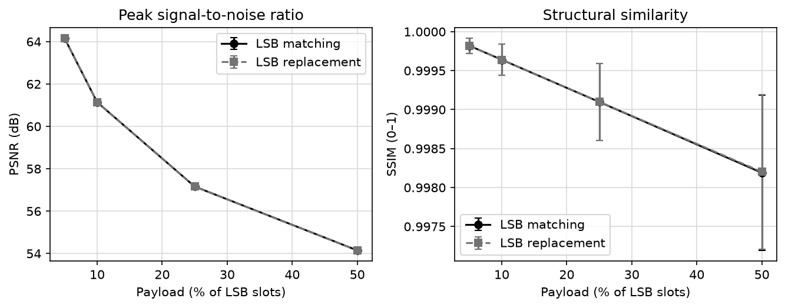
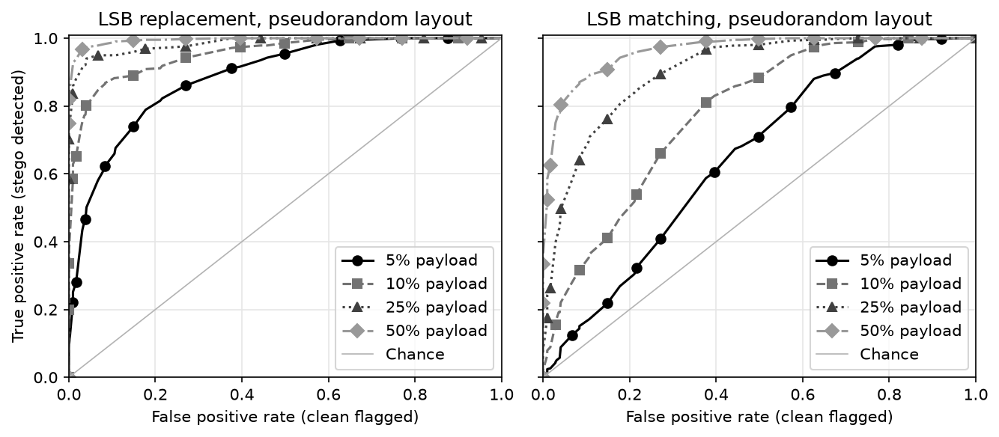

# StegoShield: Evaluation Results

All five evaluations from [revised_proposal.md](revised_proposal.md) §5. Every number comes from a script in `experiments/` (seed 2026) and is saved under `experiments/results/`. Figures are in `docs/figures/`.

**Data.** 2,100 PNG covers (512×512 crops) from 900 DIV2K photos: the 100 validation photos (5 crops each) and the 800 training photos (2 crops each). The detector was trained on 720 photos. **Every experiment uses only the 417 held-out covers from the other 180 photos.** Each script checks its covers against `experiments/results/split.csv` and refuses to run on a training cover.

**Detector.** Calibrated Random Forest on 258 features: 28 per colour channel plus 174 inter-channel features. Its yes/no threshold is **0.72**, chosen on training folds to flag at most 5 % of clean photos. Probabilities are calibrated; "detected" below always means probability ≥ 0.72.

**Reproduce** (after `python -m ml.prepare_covers && python -m ml.dataset`):

```bash
python -m experiments.quality          # ~3 min on 7 cores
python -m experiments.detector_eval    # seconds (uses the feature table)
python -m experiments.preflight_eval   # ~15 min on 7 cores
python -m experiments.robustness       # ~15 s (20 covers)
python -m experiments.security         # ~10 s
python -m experiments.attacks          # ~5 s
```

`quality` and `detector_eval` give byte-identical CSVs on every run. `preflight_eval` and `robustness` hide real format-v2 messages, whose keys and salts come from `os.urandom` as in production. Their message content and predictions are seeded, but individual detector scores vary slightly between runs.

---

## 1. Visual quality

| Payload | PSNR (dB), replacement | PSNR (dB), matching | SSIM, replacement | SSIM, matching |
|---|---|---|---|---|
| 5 % | 64.15 ± 0.02 | 64.15 ± 0.02 | 0.99982 ± 0.00010 | 0.99982 ± 0.00010 |
| 10 % | 61.14 ± 0.01 | 61.14 ± 0.02 | 0.99964 ± 0.00020 | 0.99964 ± 0.00020 |
| 25 % | 57.16 ± 0.01 | 57.16 ± 0.01 | 0.99910 ± 0.00049 | 0.99910 ± 0.00050 |
| 50 % | 54.15 ± 0.01 | 54.15 ± 0.01 | 0.99820 ± 0.00099 | 0.99819 ± 0.00100 |

Mean ± standard deviation over 417 held-out covers, pseudorandom layout. Source: `experiments/results/quality_summary.csv`.



Even a 50 % payload leaves PSNR above 54 dB, far above the ~40 dB where differences start to become visible. Doubling the payload costs exactly 3 dB, as expected when about half the touched values change by 1. Replacement and matching give the same quality, because both change the same number of values by exactly 1. **Quality is not a reason to choose between them; detectability is (§2).**

## 2. Detector performance

ROC-AUC on held-out covers (threshold-free):

| Payload | Replacement, pseudorandom | Replacement, sequential | Matching, pseudorandom | Matching, sequential |
|---|---|---|---|---|
| 5 % | 0.886 | 0.824 | 0.651 | 0.609 |
| 10 % | 0.953 | 0.919 | 0.778 | 0.695 |
| 25 % | 0.984 | 0.972 | 0.902 | 0.832 |
| 50 % | 0.995 | 0.992 | 0.963 | 0.931 |

Share of stego images caught at the 0.72 threshold:

| Payload | Replacement, pseudorandom | Replacement, sequential | Matching, pseudorandom | Matching, sequential |
|---|---|---|---|---|
| 5 % | 50 % | 38 % | 9 % | 6 % |
| 10 % | 80 % | 65 % | 22 % | 11 % |
| 25 % | 94 % | 86 % | 50 % | 32 % |
| 50 % | 97 % | 96 % | 80 % | 64 % |

Each cell is 417 clean covers vs 417 stego images. **Clean photos wrongly flagged: 4.1 %** (17 of 417). Overall (all 16 conditions pooled): ROC-AUC 0.868, balanced accuracy 0.755, precision 0.995. Accuracy, precision, recall and false-alarm rate per cell are in `experiments/results/detector_metrics.csv`.



**LSB replacement** is found reliably: AUC 0.89 at just 5 %, above 0.98 from 25 % up. The top features are the per-channel Sample Pairs Analysis estimates. **LSB matching (±1)** is harder but no longer invisible: AUC 0.65 at 5 % rising to 0.96 at 50 %. The inter-channel features make this possible. In a camera photo the pixel noise is correlated across R, G and B, and ±1 embedding changes each channel independently, which roughens the channel-difference planes. Matching remains clearly less detectable than replacement at every size, so it stays the web app's default. Pseudorandom layout is caught slightly *more* often than sequential, probably because sequential embedding fills the top rows first and leaves the rest of the image untouched, which dilutes whole-image statistics.

**How the detector got here.** The first model (84 per-channel features, 100 photos) reached ROC-AUC 0.731 overall and could not see matching at all (AUC 0.51–0.57). Adding the inter-channel family and 800 more source photos raised overall AUC to 0.868 and matching at 50 % to 0.963. At the default 0.5 threshold the new model flagged 15 % of clean photos. Tuning the threshold on training folds cut that to 4 % while keeping AUC unchanged; 55 % of all stego images are caught (vs 40 % before).

## 3. Pre-flight validity

Does a predicted risk level match how often the detector actually catches a real message of that size?

| Predicted level | All covers | Smooth covers | Textured covers |
|---|---|---|---|
| Low (< 35 %) | **0.0 %** detected (n = 540) | 0.0 % (n = 216) | 0.0 % (n = 324) |
| Medium | 1.7 % (n = 544) | 0.9 % (n = 228) | 2.2 % (n = 316) |
| High (> 65 %) | **88.1 %** detected (n = 2,252) | 90.3 % (n = 1,220) | 85.4 % (n = 1,032) |

417 held-out covers × 2 algorithms × 4 payload shares = 3,336 trials. "Detected" means the detector's probability on the real stego image reached the 0.72 threshold. Smooth / textured split at the median Laplacian variance. Source: `experiments/results/preflight_eval_summary.csv`.


The pre-flight check is a reliable guide. **No message predicted Low was detected (0 of 540), and 88 % of those predicted High were.** Predicted and actual probabilities agree closely (Spearman ρ = 0.985). The High band starts at 65 %, below the 72 % decision threshold, so a High prediction is a warning rather than a guarantee of detection; that is why its detection rate is 88 % and not 100 %. Texture changes detectability little for this detector, because its strongest features measure embedding relative to each image. The algorithm and the payload drive the level:

| Actually detected | 5 % | 10 % | 25 % | 50 % |
|---|---|---|---|---|
| Replacement | 48.7 % | 80.1 % | 93.3 % | 97.4 % |
| Matching | 7.7 % | 22.1 % | 49.4 % | 79.1 % |

With matching, 447 of 1,668 trials were predicted Low; with replacement, 93.

## 4. Transport robustness

| Transport | Recovered | Failed safely | Unsafe |
|---|---|---|---|
| PNG re-save | **40 / 40** | 0 | 0 |
| JPEG quality 90 | 0 | **40 / 40** | 0 |
| JPEG quality 75 | 0 | **40 / 40** | 0 |
| Resize to 50 % | 0 | **40 / 40** | 0 |

20 held-out covers × 2 key modes (password, public key), 1 KB message, LSB matching. "Failed safely" means the reveal raised `AuthenticationError` or `InvalidPayloadError` and returned nothing. Source: `experiments/results/robustness_summary.csv`.


As designed, the message survives lossless re-saving only. JPEG compression (even at quality 90) and resizing rewrite least significant bits, so the message is lost. In every one of the 120 lossy trials the failure was **safe**: no partial plaintext, no garbage, no crash. Messages must travel as PNG files (for example as a document attachment), never as a photo that a messaging app recompresses.

## 5. Security & integrity

All **32** security tests pass (10 in `tests/test_security.py`, 22 in `tests/test_crypto.py`). Source: `experiments/results/security.csv`. The live attack demos (`experiments/attacks.py`, 5 held-out covers) recover the control message every time and fail safely on every attack. The threat-by-threat mapping is in [tests/security_results.md](../tests/security_results.md):

| Attack | Result |
|---|---|
| Bit flips in the packet or in pixels | `AuthenticationError`, no plaintext |
| Header tampering | `AuthenticationError` (header is AES-GCM AAD) |
| Wrong password / wrong private key | `AuthenticationError` |
| Cropping | Fails safely, no crash |
| Keyless extraction with only the public key | Recovers only fresh random bytes, no marker |
| Cheap password guessing | Impossible: every guess costs a full PBKDF2 run (600k iterations) |
| Signature scan for `STSH` | Not found, even in sequential mode |

Encryption hides the content but not the act of embedding. §2 shows that hiding is statistically detectable, strongly for replacement and at larger payloads for matching, and §4 that lossy transport destroys the message. Both are limits of spatial-domain LSB steganography, measured and reported here rather than hidden.
