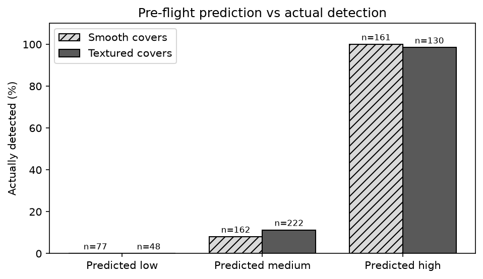
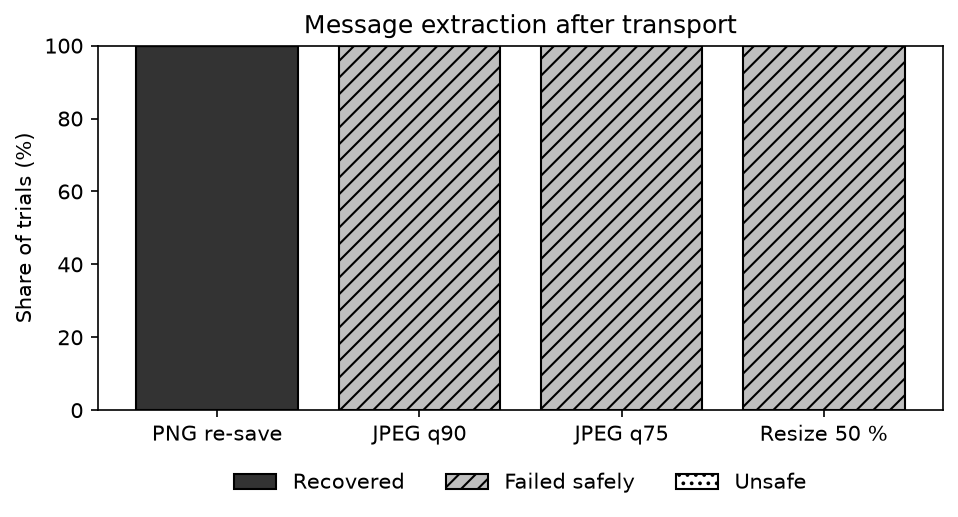

# StegoShield: Evaluation Results

All five evaluations from [revised_proposal.md](revised_proposal.md) §5. Every number comes from a script in `experiments/` (seed 2026) and is saved under `experiments/results/`. Figures are in `docs/figures/`.

**Data.** 500 PNG covers (512×512 crops, 5 per photo) from 100 DIV2K validation photos. The detector was trained on 80 photos. **Every experiment uses only the 100 held-out covers from the other 20 photos.** Each script checks its covers against `experiments/results/split.csv` and refuses to run on a training cover.

**Reproduce** (after `python -m ml.prepare_covers && python -m ml.dataset`):

```bash
python -m experiments.quality          # ~1 min
python -m experiments.detector_eval    # seconds (uses the feature table)
python -m experiments.preflight_eval   # ~4 min on 7 cores
python -m experiments.robustness       # ~15 s (20 covers)
python -m experiments.security         # ~5 s
```

`quality` and `detector_eval` give byte-identical CSVs on every run. `preflight_eval` and `robustness` hide real format-v2 messages, whose keys and salts come from `os.urandom` as in production. Their message content and predictions are seeded, but individual detector scores vary slightly between runs.

---

## 1. Visual quality

| Payload | PSNR (dB), replacement | PSNR (dB), matching | SSIM, replacement | SSIM, matching |
|---|---|---|---|---|
| 5 % | 64.15 ± 0.02 | 64.15 ± 0.02 | 0.99982 ± 0.00011 | 0.99982 ± 0.00011 |
| 10 % | 61.14 ± 0.02 | 61.14 ± 0.02 | 0.99964 ± 0.00021 | 0.99964 ± 0.00022 |
| 25 % | 57.16 ± 0.01 | 57.16 ± 0.01 | 0.99911 ± 0.00052 | 0.99910 ± 0.00054 |
| 50 % | 54.15 ± 0.01 | 54.15 ± 0.01 | 0.99824 ± 0.00101 | 0.99820 ± 0.00108 |

Mean ± standard deviation over 100 held-out covers, pseudorandom layout. Source: `experiments/results/quality_summary.csv`.


Even a 50 % payload leaves PSNR above 54 dB, far above the ~40 dB where differences start to become visible. Doubling the payload costs exactly 3 dB, as expected when about half the touched values change by 1. Replacement and matching give the same quality, because both change the same number of values by exactly 1. **Quality is not a reason to choose between them; detectability is (§2).**

## 2. Detector performance

| Payload | Replacement, pseudorandom | Replacement, sequential | Matching, pseudorandom | Matching, sequential |
|---|---|---|---|---|
| 5 % | 0.866 | 0.803 | 0.512 | 0.507 |
| 10 % | 0.922 | 0.905 | 0.520 | 0.516 |
| 25 % | 0.986 | 0.973 | 0.537 | 0.535 |
| 50 % | 0.998 | 0.998 | 0.566 | 0.561 |

ROC-AUC on held-out covers. Each cell is 100 clean covers vs 100 stego images. Overall (all 16 conditions pooled): ROC-AUC 0.731, balanced accuracy 0.694. Accuracy, precision and recall per cell are in `experiments/results/detector_metrics.csv`.


The detector finds **LSB replacement** reliably: AUC 0.87 at just 5 %, and above 0.98 from 25 % up. The top features are the per-channel Sample Pairs Analysis estimates. **LSB matching (±1) is close to undetectable** with these hand-crafted features: AUC 0.51 to 0.57 at every payload, near the chance line. This is the known weakness of statistical LSB detectors, and the reason the web app hides with matching by default. Layout makes little difference (pseudorandom vs sequential is within 0.07 everywhere), so scattering bits mainly serves secrecy, not stealth.

## 3. Pre-flight validity

Does a predicted risk level match how often the detector actually catches a real message of that size?

| Predicted level | All covers | Smooth covers | Textured covers |
|---|---|---|---|
| Low (< 35 %) | **0.0 %** detected (n = 125) | 0.0 % (n = 77) | 0.0 % (n = 48) |
| Medium | 9.9 % (n = 384) | 8.0 % (n = 162) | 11.3 % (n = 222) |
| High (> 65 %) | **99.3 %** detected (n = 291) | 100 % (n = 161) | 98.5 % (n = 130) |

100 held-out covers × 2 algorithms × 4 payload shares = 800 trials. "Detected" means the detector's probability on the real stego image was ≥ 0.5. Smooth / textured split at the median Laplacian variance. Source: `experiments/results/preflight_eval_summary.csv`.



The pre-flight check is a reliable guide. **No message predicted Low was detected, and 99 % of those predicted High were.** Predicted and actual probabilities agree closely (Spearman ρ = 0.98). This holds equally for smooth and textured covers. Texture does not change detectability much for this detector, because Sample Pairs Analysis measures embedding relative to each image's own pixel pairs. (This is why the Phase 4 sanity test no longer assumes that smooth covers are riskier; see `phases.md`.) In practice the level is driven by the algorithm. With matching, 117 of 400 trials were predicted Low and only 9 High. With replacement, 8 were predicted Low and 282 High.

## 4. Transport robustness

| Transport | Recovered | Failed safely | Unsafe |
|---|---|---|---|
| PNG re-save | **40 / 40** | 0 | 0 |
| JPEG quality 90 | 0 | **40 / 40** | 0 |
| JPEG quality 75 | 0 | **40 / 40** | 0 |
| Resize to 50 % | 0 | **40 / 40** | 0 |

20 held-out covers × 2 key modes (password, public key), 1 KB message, LSB matching. "Failed safely" means the reveal raised `AuthenticationError` or `InvalidPayloadError` and returned nothing. Source: `experiments/results/robustness_summary.csv`.



As designed, the message survives lossless re-saving only. JPEG compression (even at quality 90) and resizing rewrite least significant bits, so the message is lost. In every one of the 120 lossy trials the failure was **safe**: no partial plaintext, no garbage, no crash. Messages must travel as PNG files (for example as a document attachment), never as a photo that a messaging app recompresses.

## 5. Security & integrity

All **32** security tests pass (10 in `tests/test_security.py`, 22 in `tests/test_crypto.py`). Source: `experiments/results/security.csv`. The threat-by-threat mapping is in [tests/security_results.md](../tests/security_results.md):

| Attack | Result |
|---|---|
| Bit flips in the packet or in pixels | `AuthenticationError`, no plaintext |
| Header tampering | `AuthenticationError` (header is AES-GCM AAD) |
| Wrong password / wrong private key | `AuthenticationError` |
| Cropping | Fails safely, no crash |
| Keyless extraction with only the public key | Recovers only fresh random bytes, no marker |
| Cheap password guessing | Impossible: every guess costs a full PBKDF2 run (600k iterations) |
| Signature scan for `STSH` | Not found, even in sequential mode |

Encryption hides the content but not the act of embedding. §2 shows that hiding with LSB replacement is statistically detectable, and §4 that lossy transport destroys the message. Both are limits of spatial-domain LSB steganography, measured and reported here rather than hidden.
